# 🟣 Purple-Team Lab — Web Application Attack & Defense (Wazuh)

A self-contained **purple-team exercise**: I played both attacker and defender against a web server I built and monitored. The goal was to run a realistic full-chain web attack and prove that **Wazuh** could detect — and in one case automatically stop — each stage, then honestly assess where a host-based SIEM is blind.


> ⚠️ **Lab disclaimer.** Carried out in an isolated, host-only lab I designed and own, using standard public tools (Nmap, Medusa, curl) against **DVWA**, an intentionally vulnerable app. This repository documents the **detection and defensive** side; offensive steps are described at a high level only. Deeper detail is in the PDFs under [`docs/`](docs/).

---

## 🏗️ Lab Architecture

```
┌────────────────────┐   attacks   ┌────────────────────┐   logs/FIM   ┌──────────────────┐
│  Kali (Red)        │ ──────────▶ │  ubuntu-dvwa       │ ───────────▶ │  Wazuh (Blue)    │
│  192.168.64.7      │             │  192.168.64.8      │   (agent 002)│  manager: soc-waz│
│  Nmap/Medusa/curl  │ ◀────────── │  Apache + DVWA     │              │  rules + Active  │
└────────────────────┘  firewall   └────────────────────┘              │  Response        │
      drop (Active Response)                                        └──────────────────┘
      Isolated host-only network — 192.168.64.0/24
```

**What I built (defensive setup):** agent enrolment on the target · log collection (Apache access/error, `/var/log/auth.log`, UFW) · **realtime File Integrity Monitoring** on `/var/www/html` · **Active Response** (firewall-drop) bound to the SSH brute-force rule with a 300s timeout.

---

## 🔗 Attack Chain & Detection Coverage

| # | Stage | MITRE | What Wazuh detected | Result |
|---|---|---|---|---|
| 1 | Reconnaissance (Nmap) | T1595 / T1046 | *Nothing* — host-based SIEM limitation | ⚠️ Gap |
| 2 | SSH brute force | T1110 | Rule **5712** (level 10) | ✅ Detected |
| 3 | Automated response | — | Rules 651 / 652 (firewall-drop) | 🛡️ Auto-blocked |
| 4 | SQL injection | T1190 | Rule **31106** | ✅ Detected |
| 5 | Web shell upload | T1505.003 | Rule **554** (FIM, realtime) | ✅ Detected |
| 6 | Remote command execution | T1059 | Rule **31514** (×4) | ✅ Detected |

---

## 🔎 Investigation Workflow

A real analyst starts from something anomalous and pivots — not from rule numbers.

**1. Triage** — reviewing the host surfaced a spike: **506 events** on `ubuntu-dvwa` in a short burst.
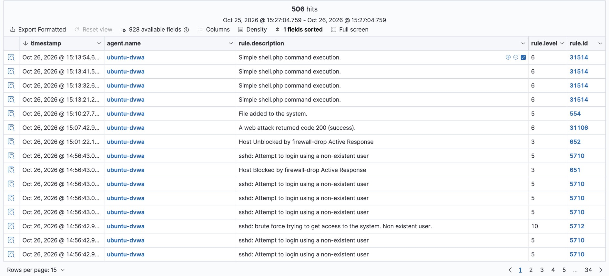

**2. Scope** — filtering on `data.srcip:192.168.64.7` narrowed it to **one attacker and the whole kill chain** (79 events, in order).
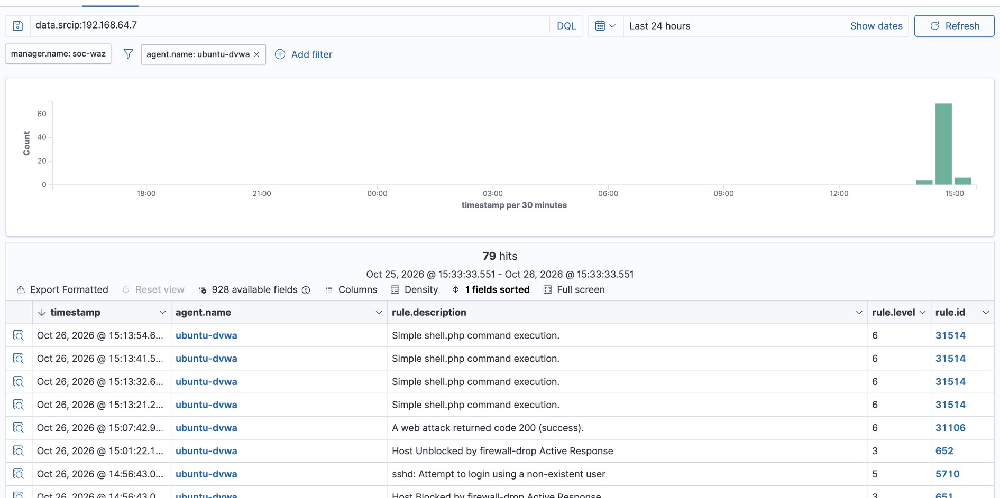

---

## 🧱 Detections by Stage

### SSH Brute Force — Rule 5712 (T1110)
Repeated failed logins (rule 5710) are correlated into a single high-severity brute-force alert, auto-mapped to MITRE and to PCI-DSS / HIPAA / NIST 800-53.
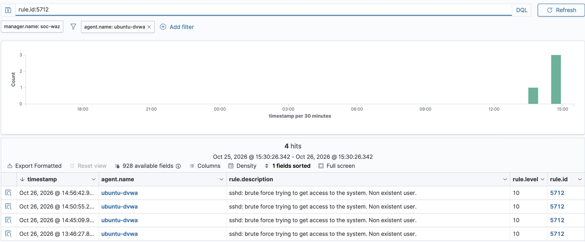
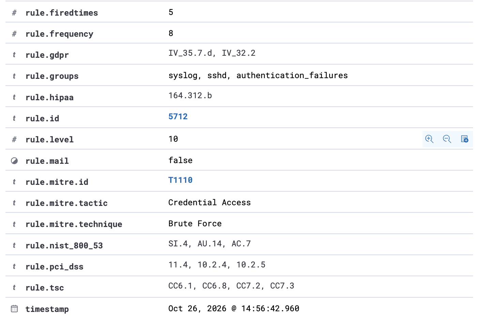

### Automated Containment — Active Response (651 / 652)
The moment rule 5712 fired, Wazuh ran `firewall-drop` and blocked the attacker's IP automatically — no analyst in the loop. The block/unblock cycle (300s timeout) is visible in the SIEM and matches the stalls in the attacker's own tooling.
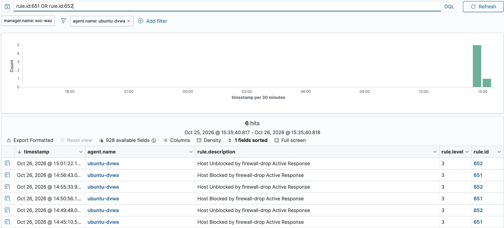
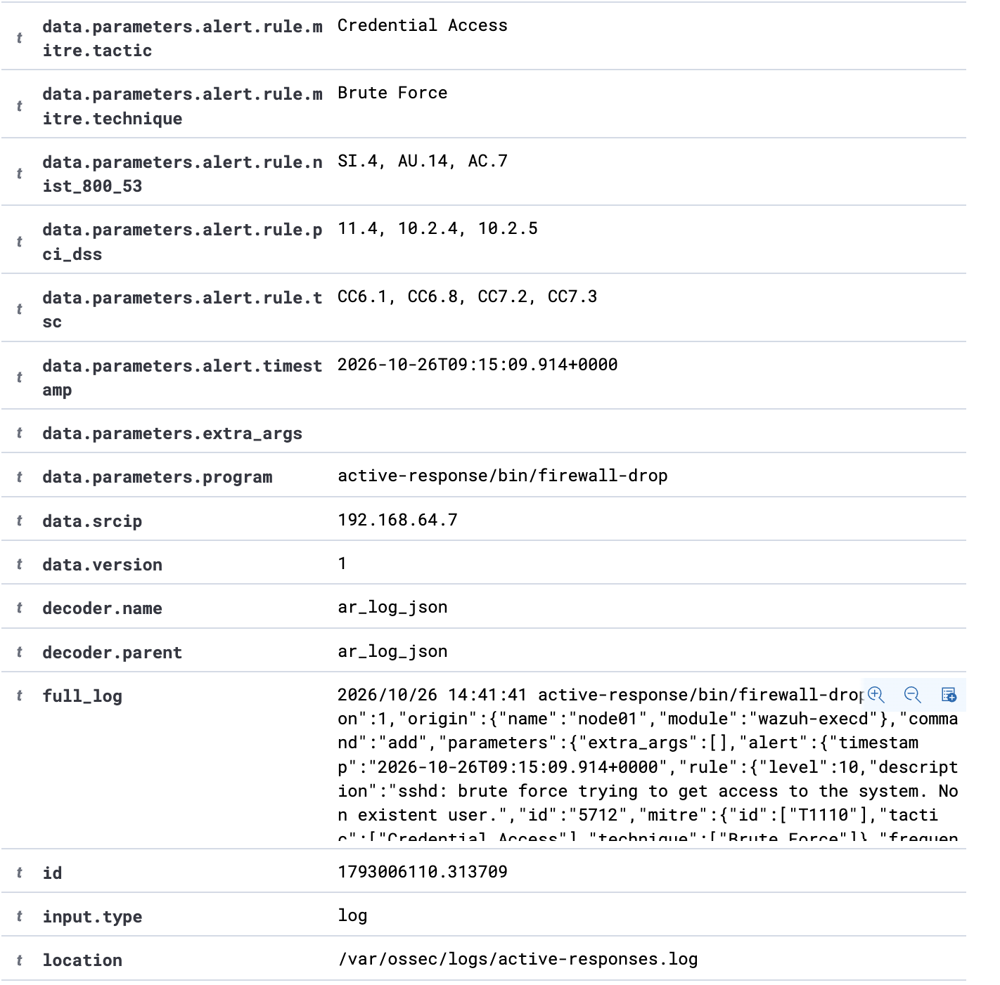

> **Detection *and* response, end to end, with zero human action** — the brute force never succeeded.

### SQL Injection — Rule 31106 (T1190)
Apache logs shipped to Wazuh captured the injection. Rule 31106 ("a web attack returned code 200") fired — the 200 means the malicious request succeeded. The exact payload is readable straight off the alert.
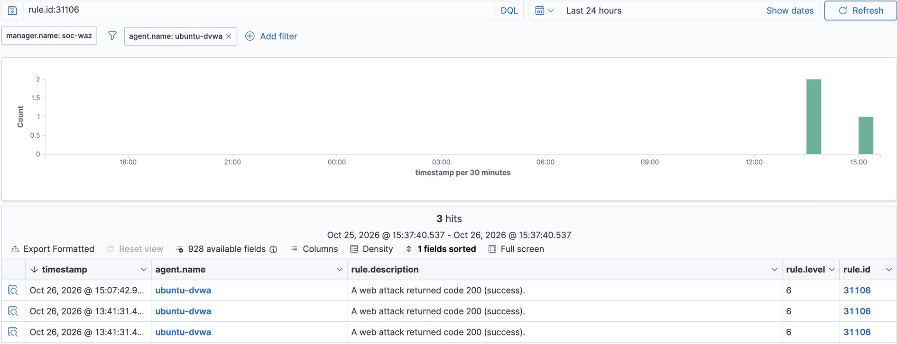
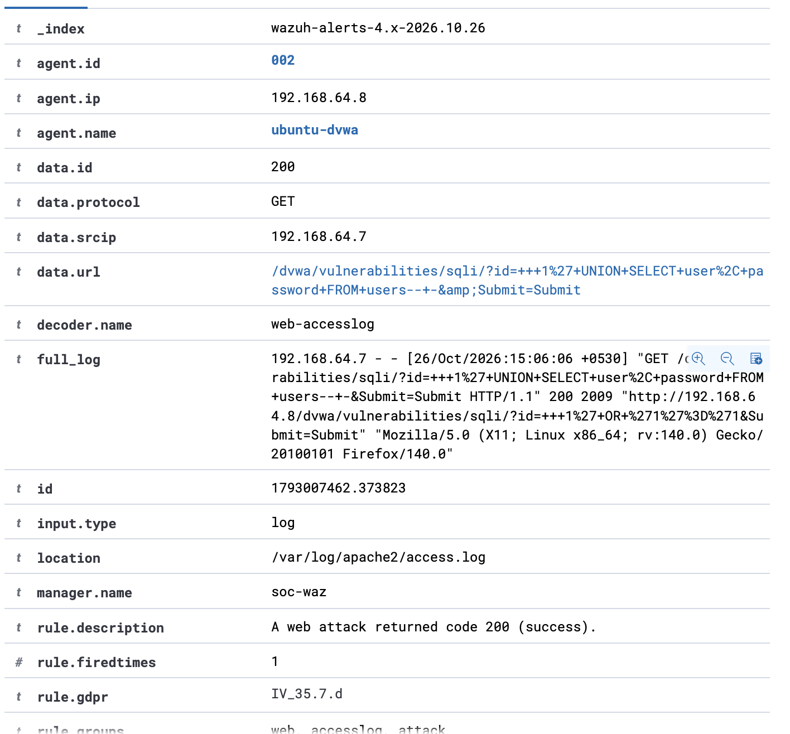

### Web Shell Dropped — Rule 554 (File Integrity Monitoring)
Because `/var/www/html` is under realtime FIM, the uploaded PHP web shell was flagged **the instant it touched disk — before it was ever used**. Defence in depth, independent of the web-request detection.
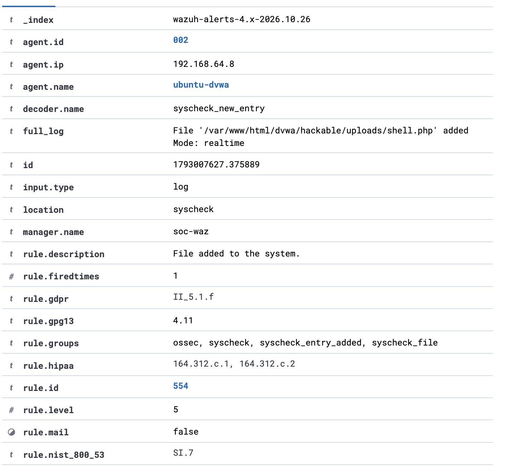

### Remote Command Execution — Rule 31514 (T1059)
Each command rode in the URL query string, so Apache logged it and Wazuh raised rule 31514 once per command, with the full command visible to the analyst.
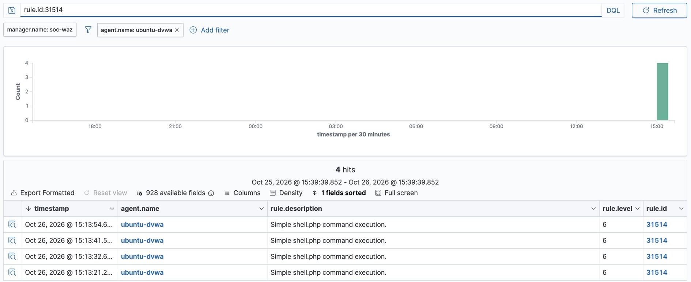
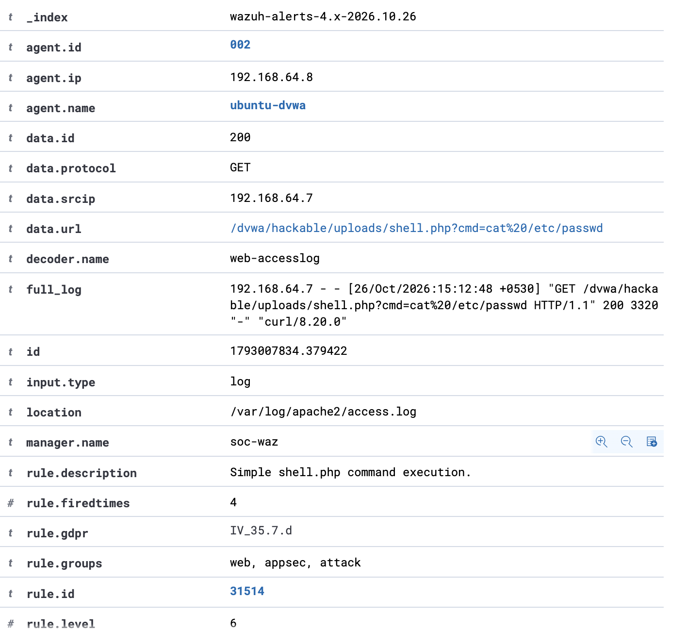

---

## 📊 Incident Dashboards

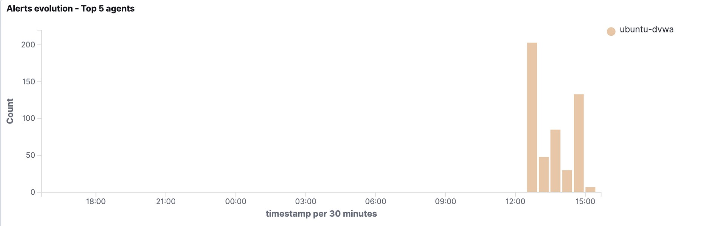
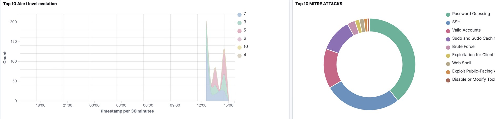

---

## ⚠️ Detection Gaps & Recommendations

An honest project names what it missed:

1. **Network recon was invisible.** Wazuh is host-based (HIDS), so the Nmap scans raised no alert. **Fix:** add a network IDS (**Suricata**) on the segment, feeding alerts into Wazuh so host + network detections share one dashboard. *(This is the planned next project.)*
2. **Command execution was detected by request, not execution.** Rule 31514 worked because the command rode in the URL; a POST-based or obfuscated shell would evade it, and the built-in rule keys on the literal name `shell.php`. **Fix:** ingest host command auditing (**auditd execve**) into Wazuh, plus behavioural rules (e.g. the web-server user spawning a shell).

---

## 📚 Skills Demonstrated

| Blue team (defence) | Red team (offence) |
|---|---|
| SIEM deployment & agent management | Network reconnaissance (Nmap) |
| Log pipeline & decoder configuration | Credential brute forcing (Medusa) |
| File Integrity Monitoring | Web exploitation (SQLi, file upload) |
| Automated response engineering | Web shell & RCE |
| Alert triage & investigation | MITRE ATT&CK-aligned emulation |
| Detection-gap analysis | Impact assessment & reporting |

---

## 📄 Full Documents

- 📘 [Project Documentation (PDF)](docs/project-documentation.pdf) — attack + detection, end to end
- 📝 [SOC Detection & Incident Response Report (PDF)](docs/soc-detection-report.pdf) — defensive (blue)
- 🔴 [Penetration Test Findings Report (PDF)](docs/pentest-findings-report.pdf) — offensive (red)
